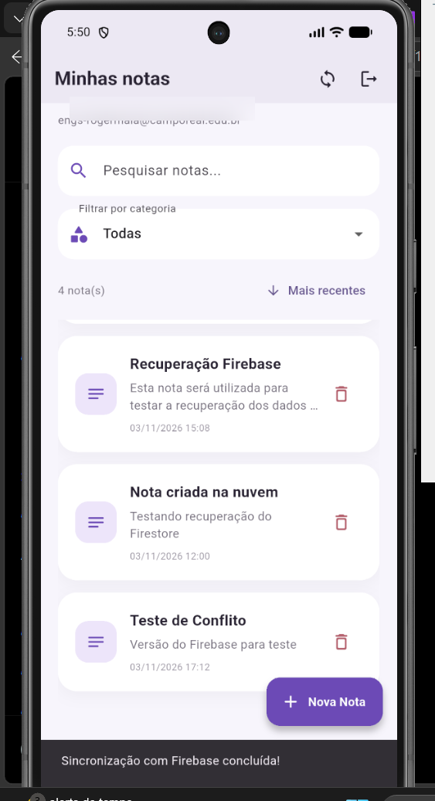
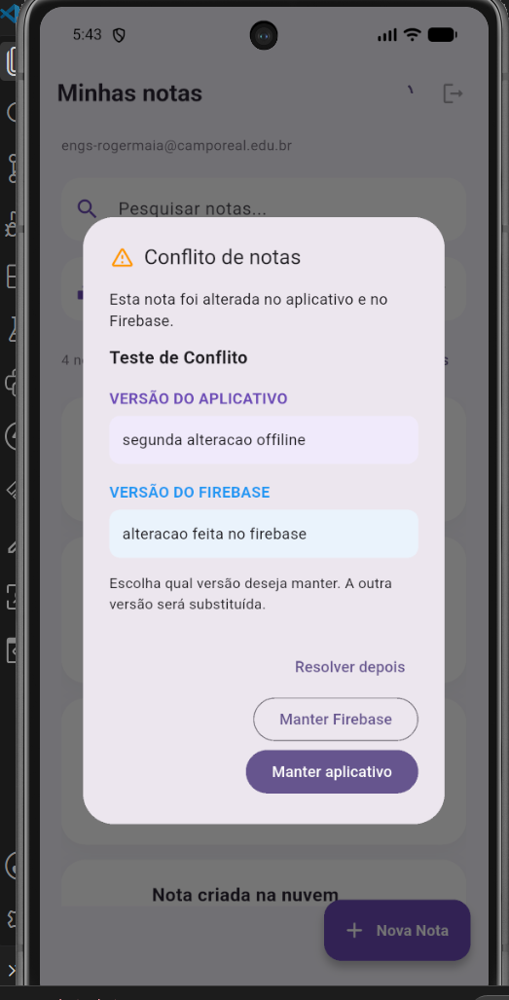
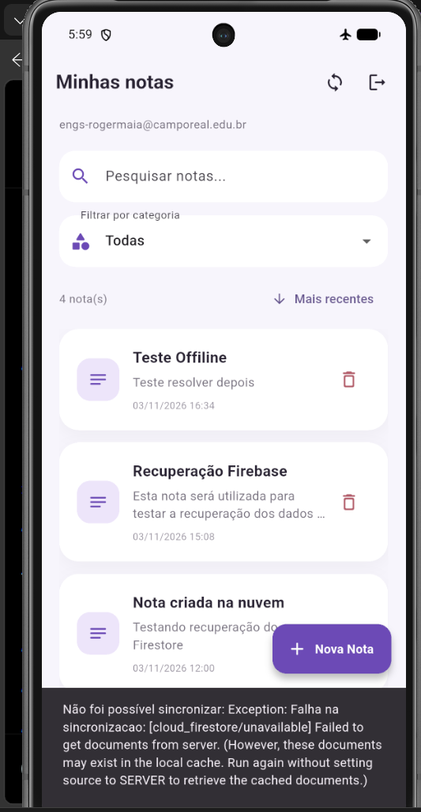
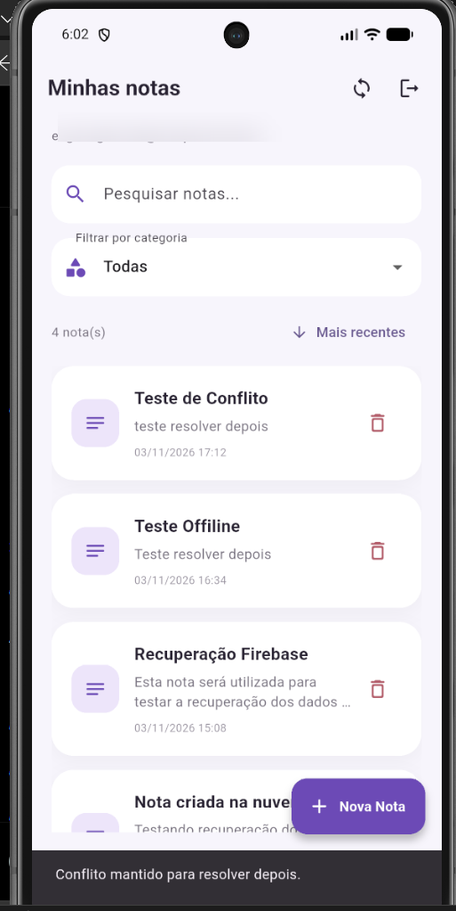

# 📝 Bloco de Notas

Aplicativo mobile desenvolvido em Flutter e Dart para criação, edição, organização e sincronização de notas pessoais. O projeto utiliza Firebase para autenticação e armazenamento na nuvem, além de SQLite para armazenamento local e funcionamento offline.

## 🎯 Objetivo do projeto

Desenvolver um aplicativo de notas que permita ao usuário registrar suas informações com facilidade, mantendo seus dados disponíveis mesmo quando não houver conexão com a internet.

O aplicativo também possui sincronização entre o dispositivo e o Firebase, incluindo mecanismos de identificação e resolução de conflitos entre versões de uma mesma nota.

## 🚀 Funcionalidades

### 👤 Autenticação
- Cadastro de usuários.
- Login com e-mail e senha.
- Autenticação utilizando Firebase Authentication.
- Manutenção da sessão autenticada no dispositivo.

### 📒 Gerenciamento de notas
- Criar novas notas.
- Editar notas existentes.
- Excluir notas.
- Organizar notas por categorias.
- Pesquisar notas pelo título ou conteúdo.
- Ordenar notas por data.

### ☁️ Sincronização com Firebase
- Armazenamento das notas no Cloud Firestore.
- Sincronização manual.
- Sincronização automática quando a conexão retorna.
- Novas tentativas de sincronização de notas pendentes.
- Sincronização de alterações e exclusões.

### 📱 Funcionamento offline
- Armazenamento local utilizando SQLite.
- Visualização das notas sem internet.
- Criação e edição de notas offline.
- Preservação das alterações locais até a sincronização.

### ⚠️ Resolução de conflitos
Quando uma mesma nota apresenta alterações diferentes no aplicativo e no Firebase, o sistema identifica o conflito e apresenta três opções:

1. **Manter aplicativo:** preserva a versão local.
2. **Manter Firebase:** utiliza a versão armazenada na nuvem.
3. **Resolver depois:** mantém o conflito pendente para uma decisão posterior.

## 🛠️ Tecnologias utilizadas

| Tecnologia | Utilização |
|---|---|
| Flutter | Desenvolvimento do aplicativo |
| Dart | Linguagem de programação |
| Firebase Authentication | Autenticação de usuários |
| Cloud Firestore | Armazenamento na nuvem |
| SQLite | Banco de dados local |
| sqflite | Integração com SQLite |
| connectivity_plus | Detecção de conectividade |
| Git e GitHub | Controle de versão |

## 📂 Organização do projeto

```text
lib/
├── database/
│   └── database_helper.dart
│
├── models/
│   └── note.dart
│
├── pages/
│   ├── login_page.dart
│   ├── register_page.dart
│   ├── notes_page.dart
│   └── note_form_page.dart
│
├── services/
│   ├── auth_service.dart
│   ├── firestore_service.dart
│   └── sync_service.dart
│
├── widgets/
│   └── note_card.dart
│
└── main.dart
```

## ⚙️ Como executar o projeto

### 1. Pré-requisitos

- Flutter instalado.
- Dart instalado.
- Visual Studio Code ou Android Studio.
- Emulador Android ou dispositivo físico.
- Projeto configurado no Firebase.

### 2. Clonar o repositório

```bash
git clone https://github.com/rogerfelipe10/bloco_de_nota_turma_A.git
```

### 3. Entrar na pasta

```bash
cd bloco_de_nota_turma_A
```

### 4. Instalar as dependências

```bash
flutter pub get
```

### 5. Configurar o Firebase

Configure o Firebase Authentication e o Cloud Firestore, utilizando os arquivos de configuração correspondentes ao projeto.

### 6. Executar o aplicativo

```bash
flutter run
```

## 🧪 Testes realizados

Durante o desenvolvimento foram realizados testes de:

- Cadastro e autenticação de usuários.
- Criação, edição e exclusão de notas.
- Armazenamento e recuperação de notas no SQLite.
- Sincronização com o Cloud Firestore.
- Acesso às notas sem conexão com a internet.
- Criação e edição de notas offline.
- Recuperação da conexão e sincronização automática.
- Identificação de conflitos entre versões.
- Testes das três opções de resolução de conflitos.

## 🔄 Controle de versão

O projeto utiliza Git e GitHub para controle de versão.

**Repositório:**  
https://github.com/rogerfelipe10/bloco_de_nota_turma_A

**Branch de desenvolvimento:**  
`melhorias-bloco-notas`

## 👨‍💻 Desenvolvedor

**Roger Felipe Farias**

Projeto acadêmico desenvolvido utilizando Flutter, Dart, Firebase e SQLite.

---

**Bloco de Notas — Suas anotações disponíveis, com ou sem internet.**


## Evidências do aplicativo

### Tela principal


### Janela de resolução de conflitos


### Funcionamento offline


### Banco de dados Firebase


### Opção Resolver depois

